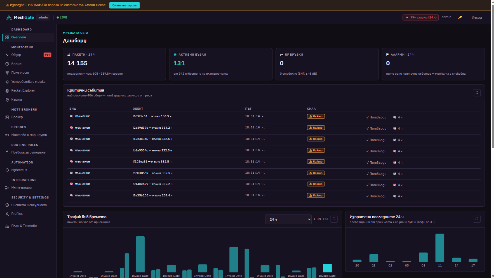
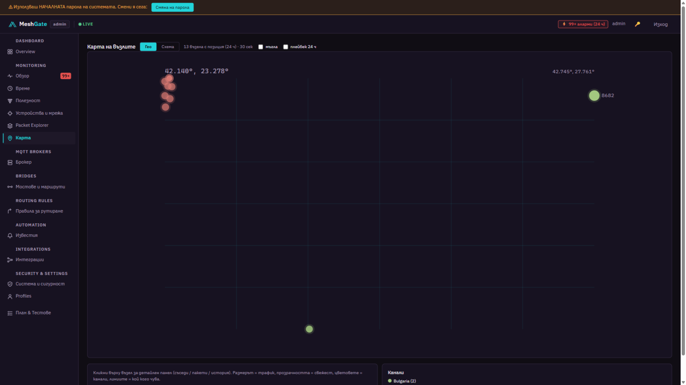
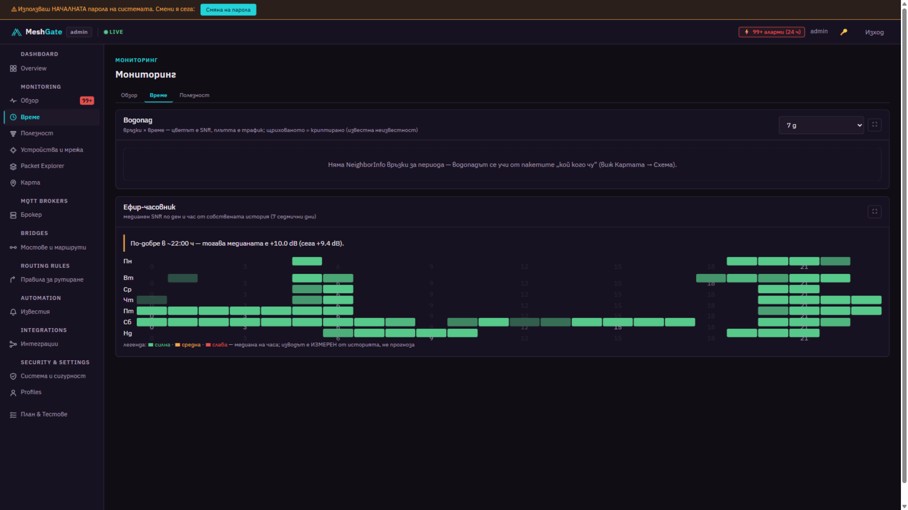
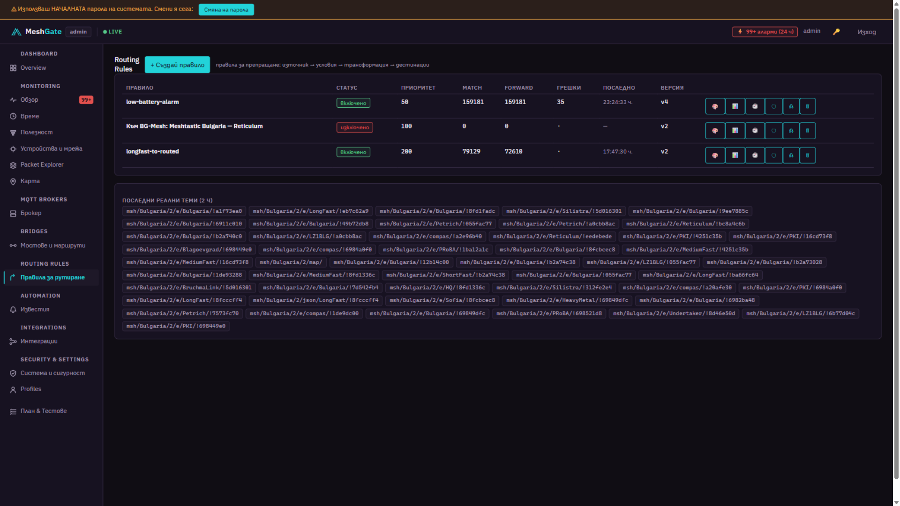
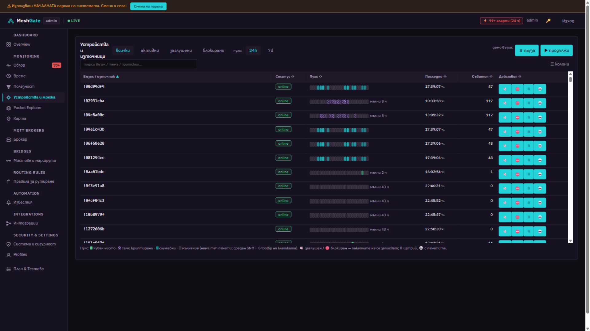
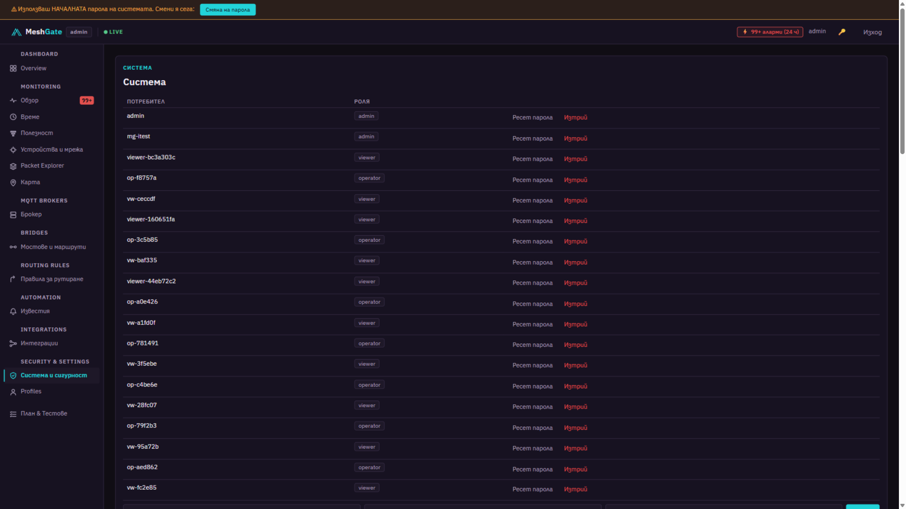

# MeshGate

**EN:** Self-hosted MQTT gateway, mesh monitoring, controlled bridges and automation — built on the live Bulgarian Meshtastic network.
**BG:** Самостоятелна платформа за MQTT gateway, mesh мониторинг, контролирани мостове и автоматизация върху живата българска Meshtastic мрежа.

Meshtastic nodes (LoRa radios) speak over MQTT. MeshGate **listens, decodes, shows and controls**: who is where, who hears whom, who went silent, whose battery is low — and lets you build rules like *"if X → forward to Y"* with retry/dead-letter, notifications (Telegram / Email / Webhook / WhatsApp) and Home Assistant discovery. Target user: the **human operator** — node names first, IDs second; warm palette; no "mock as live" data.

**BG:** Meshtastic възлите (LoRa радиата) говорят през MQTT. MeshGate ги **слуша, декодира, показва и управлява**: кой къде е, кой кого чува, кой мълчи, кой има батерия — и позволява правила „ако X → препрати към Y" с retry/dead-letter, известия и Home Assistant. Целевият потребител е **операторът-човек**: името на възела е главното, ID-то е второстепенно.



---

## Install / Инсталация

| Path / Път | How / Как | Best for / За кого |
|---|---|---|
| **Windows one-click** / двоен клик | `deploy\start-meshgate.cmd` — checks → installs → starts → opens the UI → watchdog loop / проверява → инсталира → стартира → отваря браузъра → държи guard-loop | day-to-day operation / всекидневна работа |
| **Windows .exe** | `MeshGate-installer-*.exe` (self-extracting; built by / строи се с `deploy/make-installer.sh`) | hand-over as a single file / предаване като един файл |
| **Linux one command** / една команда | `bash deploy/install-linux.sh` (add / с `--service` → systemd auto-start on boot) | servers / Raspberry Pi |
| **Fresh machine / нова машина** | `curl -fsSL https://raw.githubusercontent.com/MalinchevART/MeshGate/main/deploy/bootstrap.sh \| bash` | zero-git-knowledge setup |

Requirements / Изисквания: Windows 10/11 or Linux, 4 GB RAM, Git, Docker Desktop (Windows) / Docker Engine (Linux) — the installers set these up if missing / инсталаторите ги донастройват, ако липсват.

The installer is **idempotent**: it checks what the machine has, asks permission, installs the missing pieces, generates `deploy/.env` and prints the **initial admin password** (the UI asks you to change it on first login).
**Инсталаторът е идемпотентен**: проверява какво има, пита за разрешение, инсталира липсващото, генерира `deploy/.env` и отпечатва **началната admin парола** (UI-ят иска смяна при първи вход).

Web UI / Уеб: **http://localhost/**

## Screenshots / Екрани

| Map with fog, playback & geofences / Карта с мъгла, плейбек и геозони | Network in time: waterfall & air-clock / Мрежата във времето |
|---|---|
|  |  |
| **Routing rules / Правила за рутиране** | **Devices / Устройства** |
|  |  |
| **System: geofences, PSK keys, users / Система: геозони, PSK ключове, потребители** | **Utility funnel / Фунията** |
|  |  |

## What's inside / Какво има вътре

1. **MQTT Gateway** — broker, clients, topics, ACLs, bridges to public brokers with filters, rate limits, loop protection and audit / брокер, клиенти, теми, достъпи, мостове с филтри и защита от цикли.
2. **Mesh Network Monitor** — decode (JSON + binary protobuf), live packet explorer, RF topology, dual map (geo + schematic), waterfall, air-clock, heard-by matrix / декодиране, жив explorer, топология, дуална карта, водопад, ефир-часовник.
3. **Automation** — routing rules (AND/OR groups, branches with own error policies, priorities, hold-back, preview & validation), notifications with quiet hours + morning digest, critical events (battery / dead-letter / silence / geofence) with ack & snooze / правила, известия, критични събития.
4. **Integrations** — Home Assistant (MQTT Discovery), gateways×channels cross-reference, webhook / HA discovery и кръстосана референция на гейтовете.

## Documentation / Документация

| File | What / Какво |
|---|---|
| **PROJECT.md** | the project map / картата на проекта |
| **AGENTS.md** | daily journal + hard-won lessons / дневник + уроки |
| **docs/17-handover.md** | handover: state, debts, next steps / предаване |
| **docs/16…01** | the (completed) design plan, architecture, data models, API, deployment… / (завършеният) план |
| **docs/adr/** | decision records 001…009 / решенията |

Binding principles / Обвързващи принципи (full: docs/01): MQTT traffic goes through the broker, never through the UI/API; real data or an honestly labeled empty state; outbound bridging is off by default; broker admin credentials never reach the browser.

## Tests / Тестове

```bash
docker compose run --rm --no-deps -v "../apps/api/tests:/srv/tests" api python -m pytest tests/unit -q
docker compose run --rm --no-deps -e MESHGATE_API=http://api:8000 \
  -v "../apps/api/tests:/srv/tests" api python -m pytest tests/integration -q
```

141 unit + 18+ integration as of handover / към предаването.

## License / Лиценз

Private project — all rights reserved by the owner / Частен проект — всички права са на собственика.
